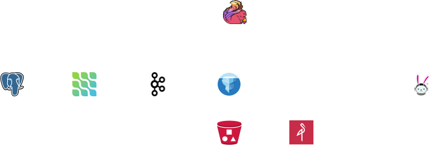

# MySQL Deployment


/// caption
Architecture Overview
///

Make sure you have deployed a Kafka cluster first.

!!! success "Deployment Steps"

    - [x] [Deploy a Kafka Cluster via the Strimzi Operator](./deployment-kafka-cluster.md)
    - [ ] [Deploy a MySQL Database](./deployment-mysql.md)
    - [ ] [Deploy a Debezium Kafka Source Connector](./deployment-debezium-mysql-connector.md)
    - [ ] [Deploy an Iceberg Kafka Sink Connector](./deployment-iceberg-connector.md)

After the Kafka cluster is up and running, you can deploy MySQL by running the following commands:

```bash
cd ~/Projects/retail-lakehouse/mysql
bash /install.sh
```

??? info "Result"

    ```
    service/mysql created
    deployment.apps/mysql created
    ```

The `install.sh` script in the `mysql` directory is as follows:

??? info "install.sh"

    ```bash
    --8<-- "./retail-lakehouse/mysql/install.sh"
    ```

You can check the `mysql.yaml` file in the `mysql` directory:

??? info "mysql.yaml"

    ```yaml
    --8<-- "./retail-lakehouse/mysql/mysql.yaml"
    ```

To verify that MySQL is running, you can use the following command:

```bash
kubectl get all -n ecommerce-app
```

??? info "Result"

    ```
    NAME                         READY   STATUS    RESTARTS   AGE
    pod/mysql-78567bd566-75l9b   1/1     Running   0          10m

    NAME            TYPE        CLUSTER-IP   EXTERNAL-IP   PORT(S)    AGE
    service/mysql   ClusterIP   None         <none>        3306/TCP   10m

    NAME                    READY   UP-TO-DATE   AVAILABLE   AGE
    deployment.apps/mysql   1/1     1            1           10m

    NAME                               DESIRED   CURRENT   READY   AGE
    replicaset.apps/mysql-78567bd566   1         1         1       10m
    ```

Perfect! You have successfully deployed MySQL. Next, you can proceed to [*Deploy the Debezium MySQL Source Connector*](./deployment-debezium-mysql-connector.md).