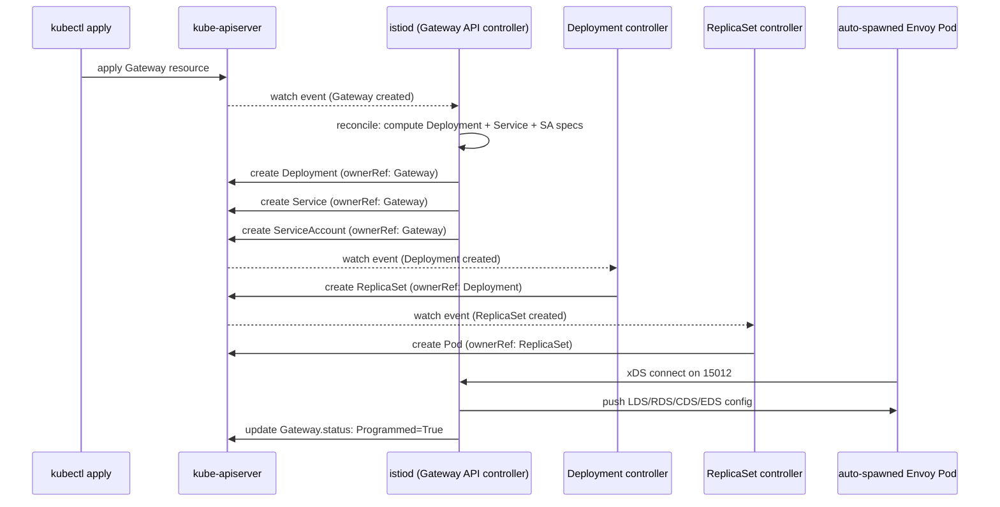

# How Gateway API Routing Works

The Kubernetes Gateway API is the SIG-Network's replacement for Ingress and for Istio's own legacy `networking.istio.io/v1beta1 Gateway` CRD. It splits ingress configuration into three cleanly separated resources — a cluster-scoped `GatewayClass`, a namespace-scoped `Gateway`, and namespace-scoped `HTTPRoute` (and siblings) — with a role-based ownership model that maps to how real organisations divide the work. Istio implements Gateway API through `istiod`'s Gateway API controller, which auto-spawns an Envoy `Deployment` for every `Gateway` resource. This means "installing an ingress gateway" is no longer a separate operation: applying a `Gateway` YAML is the install.

The API is deliberately controller-agnostic. Cilium, Envoy Gateway, Contour, and Istio all implement the same CRDs; only the `GatewayClass` name differs. That portability is why the Kubernetes community has broadly adopted it as the successor to Ingress.

## Architecture Components

`GatewayClass`
: A cluster-scoped resource declaring an ingress implementation. Its `spec.controllerName` field says which controller reconciles Gateways that reference it. Istio installs three: `istio` (auto-managed Envoy per Gateway), `istio-remote` (multi-cluster), `istio-waypoint` (per-identity L7 waypoint). Analogous to `StorageClass` for `PersistentVolume`s — an abstraction chosen by the platform team, referenced by the application team.

`Gateway`
: A namespace-scoped resource that describes a listener: what protocol, on what port, exposed to which client. Its `spec.listeners[].allowedRoutes.namespaces` field controls which namespaces' `HTTPRoute` resources may attach. The Gateway resource is what the ingress *is*; there is no separate concept of "the ingress controller pod" for the application team to worry about, because Istio auto-creates it from this resource.

`HTTPRoute`
: A namespace-scoped resource that maps HTTP matchers (path prefix, header, method) to backend Services. It references one or more `Gateway`s via `parentRefs`. Each parent attachment is evaluated independently — the same `HTTPRoute` can attach to multiple Gateways, and each attachment has its own status conditions.

`ReferenceGrant`
: A resource that authorises cross-namespace references. By default, an `HTTPRoute` in namespace `A` cannot reference a `Service` in namespace `B`; the Service's namespace owner must first create a `ReferenceGrant` in `B` allowing "HTTPRoute in namespace A". This inverts Ingress's blanket cross-namespace access and puts consent in the hands of the target namespace's owner.

Auto-spawned Envoy
: For each `Gateway` with `gatewayClassName: istio`, `istiod` creates a `Deployment` and `Service` named `<gateway-name>-<gatewayclass>` in the Gateway's namespace. This Envoy is dedicated to the one Gateway, has its own resource budget, and is garbage-collected when the Gateway is deleted through Kubernetes owner references.

## Core Concepts

### Legacy Istio Gateway CRD vs Kubernetes Gateway API

**Istio's original `networking.istio.io/v1beta1 Gateway` was a bind-by-label design: you deployed the Envoy pods yourself, gave them a label like `istio: ingressgateway`, and any `Gateway` resource with a matching `selector` would push its config to those pods.** The traffic-shaping side lived in `VirtualService` resources that referenced the `Gateway` by name. Two resources per route, one manual Envoy deployment, all Istio-specific.

Kubernetes Gateway API took the same ideas — a listener declaration decoupled from routing rules — and stripped the vendor lock-in. `Gateway` and `HTTPRoute` are upstream CRDs. Every conformant implementation supports them. `GatewayClass` picks which implementation via the controller name. Migrating from Istio to Cilium Gateway or Envoy Gateway becomes a `GatewayClass` change plus resource re-application, not a rewrite.

Istio still supports its legacy CRD for compatibility, and even ships an `istio/gateway` Helm chart that installs an Envoy Deployment expected by the legacy CRD's label-selector binding. This project removed that chart because using Gateway API renders the auto-spawn model dominant and the pre-installed Envoy is dead weight.

### The Controller Pattern Is How `istiod` Manages Gateways

**A Kubernetes controller watches resources of a type, computes desired state, and drives actual state toward it in a loop.** `istiod` runs many such loops inside one process: an xDS server for Envoy, a CA for workload certificates, an ambient reconciler, and — relevant here — a Gateway API controller.

The Gateway API controller inside `istiod` watches `Gateway`, `HTTPRoute`, `GatewayClass`, and related resources. When it sees a `Gateway` with `gatewayClassName: istio`, it creates the `Deployment`, `Service`, and `ServiceAccount` that the Gateway needs. When those child resources are created by the kube-apiserver, the standard Kubernetes Deployment controller and ReplicaSet controller take over and create the pods. `istiod` then pushes Envoy xDS config to the newly-running pod.

Every child resource is created with an `ownerReferences` entry pointing back to the `Gateway`. This is the Kubernetes-native way to encode parent-child relationships. Delete the `Gateway` and the garbage collector cascades through all descendants: Deployment, ReplicaSet, Pod, Service, ServiceAccount. No cleanup script needed.

### North-South Uses the Gateway; East-West Uses Service DNS

**Ingress gateways are for traffic entering the cluster.** Service-to-service traffic within the cluster does not go through them — it dials Kubernetes Service DNS directly (`svc-name.namespace.svc.cluster.local`).

The distinction matters because routing east-west through the Gateway would hairpin. A backend pod calling Polaris would leave its own pod's network namespace, traverse the cluster network to the ingress gateway's Envoy, hit `istiod`'s xDS-programmed route table, and come back into the cluster to Polaris. Two extra hops, one extra Envoy, no functional gain.

Ambient mode reinforces this separation. Once the source and destination namespaces are labelled `istio.io/dataplane-mode=ambient`, the per-node `ztunnel` handles L4 mTLS on the direct east-west path. No Gateway involved. The Gateway is exclusively the entry point for clients originating outside the cluster.

### Path-Prefix Routing Beats Endpoint Enumeration

Two competing patterns exist for mapping paths to backends. The first is **explicit enumeration**: list every endpoint (`/v1/jobs`, `/v1/runs`, `/v1/tables`) with its backend. The second is **prefix routing**: everything under `/v1/*` goes to one backend, everything else to another.

Prefix routing wins when the backend's API surface evolves independently of the Gateway. Adding a new endpoint doesn't require an HTTPRoute edit. It fails when different sub-paths of the same prefix legitimately need different backends — but that's a design smell in itself, usually pointing at a service that should be split.

Gateway API's **most-specific match wins** rule arbitrates between overlapping prefixes. If one HTTPRoute matches `/` and another matches `/v1/`, a request to `/v1/foo` reaches the more specific one. This lets a catch-all coexist with narrow overrides.

### `ReferenceGrant` Encodes Namespace Consent

Cross-namespace routing is opt-in from the target namespace, not from the source. If an `HTTPRoute` in `team-a` wants to send traffic to `Service/foo` in `team-b`, `team-b` must publish a `ReferenceGrant`:

```yaml
apiVersion: gateway.networking.k8s.io/v1beta1
kind: ReferenceGrant
metadata:
  name: allow-team-a-httproutes
  namespace: team-b
spec:
  from:
    - group: gateway.networking.k8s.io
      kind: HTTPRoute
      namespace: team-a
  to:
    - group: ""
      kind: Service
```

Without the grant, `HTTPRoute`'s status shows `ResolvedRefs: False` with reason `RefNotPermitted`. This is a deliberate reversal of the Ingress design — Ingress in namespace A could freely reference Services in namespace B — and it prevents a compromised namespace from silently rerouting traffic through a target it doesn't own.

This project avoids `ReferenceGrant` boilerplate by co-locating `HTTPRoute`s with their backends in the same namespace. The trade-off is that routing declarations end up owned by the same team as the backends, which suits the current structure but would need revisiting if a central platform team wanted to own all routes.

### HTTPRoute Status Is Per-Parent

An `HTTPRoute` can attach to multiple `Gateway` parents via `parentRefs`. Each attachment is a separate reconciliation with its own success/failure state, so the status structure is:

```yaml
status:
  parents:
    - parentRef: { name: gateway-1, namespace: ns-1 }
      controllerName: istio.io/gateway-controller
      conditions:
        - type: Accepted
          status: "True"
        - type: ResolvedRefs
          status: "True"
    - parentRef: { name: gateway-2, namespace: ns-2 }
      controllerName: istio.io/gateway-controller
      conditions:
        - type: Accepted
          status: "False"
          reason: NotAllowedByListeners
```

A route can be `Accepted` by Gateway 1 and rejected by Gateway 2, and both facts need to survive round-tripping through the K8s API. Top-level `.status.conditions` cannot express this. The nested structure is the correct design, but it does mean `kubectl wait --for=condition=Accepted httproute/foo` doesn't work — the condition being waited on isn't where kubectl looks. `--for=jsonpath` querying `.status.parents[0].conditions[?(@.type=="Accepted")].status` reaches the right field.

## Behind the Scenes

### What Happens When You Apply a `Gateway`

Applying one YAML file triggers a chain that spans four controllers and produces five Kubernetes objects. The end state is a running Envoy pod handling traffic.



The reason the chain has so many steps is that Kubernetes controllers are loosely coupled. `istiod` doesn't create pods directly — it creates a Deployment, and lets the standard controllers do their job. If a future release changes how `istiod` produces Envoy config, the chain from Deployment to Pod doesn't need updating. This layering is why the Kubernetes control plane can evolve without breaking downstream consumers.

### Every Auto-Spawned Resource Names Itself After the Gateway

The auto-spawned Deployment, Service, ServiceAccount, and Pod all include the Gateway's name in their name. Format: `<gateway-name>-<gatewayclass>-<pod-suffix>`. For a Gateway named `platform-gateway` under `gatewayClassName: istio`, the Deployment is `platform-gateway-istio` and its pods are `platform-gateway-istio-<replicaset-hash>-<random>`.

The `-istio` suffix comes from the GatewayClass, not from any decision by the user, and cannot be removed without switching to a different GatewayClass. This is an aesthetic wart, but it does mean that inspecting the pod name tells you the Gateway it serves and the GatewayClass that spawned it — useful in multi-tenant clusters where multiple Gateways share a namespace.

### `service-type` Annotation Overrides the Auto-Spawned Service Type

The default Service type for auto-spawned Envoy is `LoadBalancer`. On any cluster without an external load balancer provider (minikube, kind, most on-prem installs without MetalLB), the Service stays `EXTERNAL-IP: <pending>` forever, and the `Gateway.status.conditions[Programmed]` reports `False` with reason `AddressNotAssigned`.

Istio provides an annotation to override without patching the auto-created Service directly:

```yaml
metadata:
  annotations:
    networking.istio.io/service-type: ClusterIP
```

`istiod` reads the annotation from the `Gateway` metadata during reconciliation and applies it to the Service it creates. The Gateway's `Programmed` condition then flips to `True` once Envoy connects to `istiod`'s xDS. External access falls back to `kubectl port-forward`, `minikube tunnel`, or explicit NodePort — none of which are Gateway API concerns.

## References

- [Kubernetes Gateway API](https://gateway-api.sigs.k8s.io/) — canonical spec, resource semantics, most-specific-match rules
- [Gateway API vs Ingress FAQ](https://gateway-api.sigs.k8s.io/reference/faq/) — the SIG's own explanation of why Ingress is being replaced
- [Istio Gateway API implementation](https://istio.io/latest/docs/tasks/traffic-management/ingress/gateway-api/) — how `istiod` maps API resources to Envoy
- [Gateway API ReferenceGrant](https://gateway-api.sigs.k8s.io/api-types/referencegrant/) — cross-namespace consent model
- [Istio Gateway service annotations](https://istio.io/latest/docs/reference/config/annotations/) — full list of `networking.istio.io/*` overrides
- [Kubernetes owner references and garbage collection](https://kubernetes.io/docs/concepts/architecture/garbage-collection/) — the cascade delete mechanism
- [Kubernetes controller pattern](https://kubernetes.io/docs/concepts/architecture/controller/) — why controllers exist and how they reconcile
