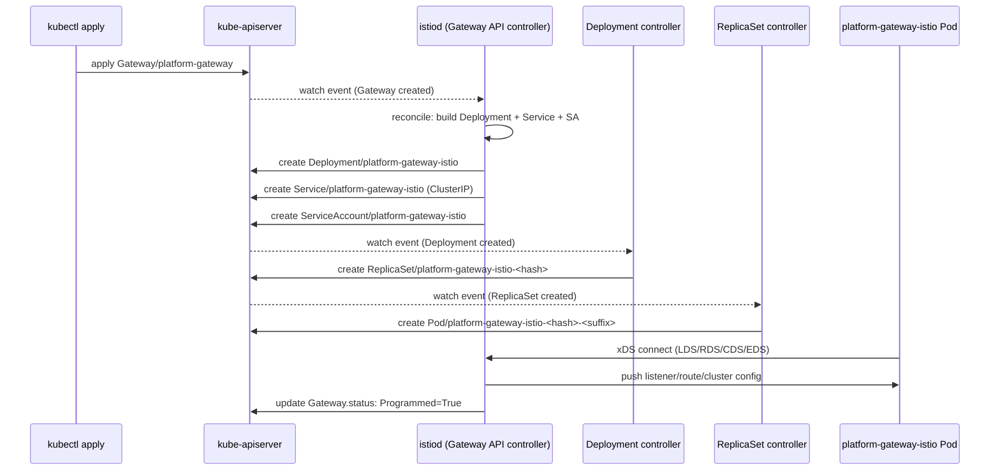

# Gateway API Routing Design

This project uses the Kubernetes Gateway API — not the legacy `networking.istio.io/v1beta1 Gateway` CRD — to expose Apache Polaris and the table-maintenance backend under a single ingress. A single `Gateway` resource in `istio-ingress` fronts two `HTTPRoute` resources in `polaris`: path prefix `/v1/` reaches the backend, everything else falls through to Polaris. All routing state lives in `polaris` alongside the backends, so no `ReferenceGrant` is required and each bounded context owns its own routing declaration.

The design leans hard on Istio's Gateway API implementation, where `istiod` acts as a controller that reconciles every `Gateway` resource into a fresh Envoy `Deployment` + `Service`. That auto-spawn model changes what "installing an ingress gateway" means and shaped several of the decisions on this page.

## Architecture Components

Gateway
: A namespace-scoped resource describing an ingress listener — protocol, port, and which namespaces' `HTTPRoute` resources are allowed to attach. Our `platform-gateway` in `istio-ingress` opens port 80 HTTP and restricts attachment to `HTTPRoute` resources in namespaces labelled `kubernetes.io/metadata.name: polaris`.

HTTPRoute
: A namespace-scoped routing rule that references one or more parent `Gateway`s and lists match/backend pairs. `polaris-catchall` is a rule with no matches (catch-all) targeting `polaris:8181`. `backend-route` matches path prefix `/v1/` and targets `table-maintenance-backend:8000`. Both live in `polaris`.

GatewayClass
: A cluster-scoped resource declaring an ingress controller implementation. Istio installs three: `istio` (the default, auto-spawns a Deployment per Gateway), `istio-remote` (for multi-cluster), and `istio-waypoint` (for east-west waypoint proxies). Our Gateway references `istio`.

Auto-spawned Envoy
: When `istiod` sees a `Gateway` with `gatewayClassName: istio`, it creates a `Deployment` and `Service` named `<gateway-name>-<gatewayclass>` in the Gateway's namespace. For `platform-gateway`, that is `platform-gateway-istio` — a fresh Envoy pod dedicated to this Gateway resource, distinct from the legacy `istio-ingressgateway` (which this project has since removed).

## Core Concepts

### North-South Traffic Uses the Gateway

**External clients enter through the Gateway; internal services never do.** North-south (client-to-cluster) traffic terminates at the auto-spawned Envoy, which routes to backend `Service`s by `HTTPRoute` rules. East-west (service-to-service) traffic bypasses the Gateway entirely and uses direct `Service` DNS.

The backend's Polaris client is the concrete example. It reads Iceberg REST endpoints via the env var:

```yaml
env:
  - name: GLAC_ICEBERG_CATALOG_URI
    value: "http://polaris.polaris.svc.cluster.local:8181/api/catalog"
```

The FQDN goes direct to the Polaris `Service`. It does not go through `platform-gateway`. Routing through the Gateway would hairpin — leaving the pod, hitting the cluster edge, coming back in — adding two hops with no functional gain. Once the `polaris` namespace joins ambient mode, `ztunnel` will HBONE-encrypt this direct east-west traffic without the Gateway's involvement.

### Path Prefix Routing Beats Explicit Endpoint Lists

The backend `HTTPRoute` uses a single prefix match:

```yaml title="platform/22-polaris-routes/backend-httproute.yaml"
spec:
  rules:
    - matches:
        - path:
            type: PathPrefix
            value: /v1/
      backendRefs:
        - name: table-maintenance-backend
          port: 8000
```

**Anything under `/v1/*` routes to the backend, everything else to Polaris.** This works because Polaris' own REST paths sit under `/api/catalog/*` and `/api/management/*` — no collision with `/v1/`. If Polaris ever adds a `/v1/` endpoint, an explicit more-specific rule in `polaris-catchall` reclaims that path (Gateway API's most-specific match wins).

The alternative — enumerating `/v1/jobs`, `/v1/runs`, `/v1/tables` explicitly — couples the Gateway config to the backend's evolving API. Prefix routing lets the backend grow without HTTPRoute edits.

### HTTPRoute Conditions Are Nested Per Parent

Every `HTTPRoute` can attach to multiple `Gateway`s via `parentRefs`, and each attachment gets its own condition block:

```yaml
status:
  parents:
    - controllerName: istio.io/gateway-controller
      parentRef:
        name: platform-gateway
        namespace: istio-ingress
      conditions:
        - type: Accepted
          status: "True"
        - type: ResolvedRefs
          status: "True"
```

`kubectl wait --for=condition=Accepted httproute/foo` **does not work** because the condition sits at `.status.parents[].conditions[]`, not `.status.conditions[]`. This project's `validate.sh` uses jsonpath to reach the nested field:

```bash title="platform/22-polaris-routes/validate.sh"
kubectl wait \
  --for=jsonpath='{.status.parents[0].conditions[?(@.type=="Accepted")].status}'=True \
  httproute/polaris-catchall \
  --namespace polaris \
  --timeout "${TIMEOUT}" \
  --context "${KUBE_CONTEXT}"
```

We check `Accepted` (Gateway admitted the route as valid) but not `ResolvedRefs` (backend `Service` exists). The backend route legitimately shows `ResolvedRefs=False` with reason `BackendNotFound` when applied before wave 25, and must not fail validation. Once wave 25 runs and creates the backend `Service`, the condition flips to `True` automatically.

### Cross-Namespace Routes Would Need `ReferenceGrant`

The Gateway API's default is that a route can only reference backends in its own namespace. Cross-namespace references need an explicit `ReferenceGrant` in the target namespace granting permission. The project sidesteps this by co-locating `HTTPRoute`s with their backends in `polaris`.

That works today because `table-maintenance-backend` and its dependencies (`tbl-maint-db`, `table-maintenance-scheduler`, the Spark `SparkApplication` template) all live in `polaris`. This was not always the case — until 2026-07-05 they lived in `default`, and moving them was scoped into the same change that added the routes.

!!! info "Why move backends into `polaris` instead of keeping `ReferenceGrant`"

    Both patterns are legitimate. Co-location avoids `ReferenceGrant` boilerplate (one fewer resource per cross-namespace edge) and puts routing declarations where the code owner already looks — the backend team's namespace has its own routes rather than a shared `istio-ingress` namespace holding everyone's declarations.

    The trade-off: `polaris` is now more than just the Iceberg catalog namespace. It hosts the catalog, the maintenance backend, the maintenance scheduler, and the backend's Postgres. Naming does drift from single-responsibility. Renaming to `catalog` or leaving it as-is is a future call.

### Ownership Cascade Deletes Auto-Spawned Envoys

Every resource `istiod` auto-creates from a `Gateway` carries an `ownerReference` pointing back to the `Gateway`:

```yaml
metadata:
  ownerReferences:
    - apiVersion: gateway.networking.k8s.io/v1beta1
      kind: Gateway
      name: platform-gateway
      uid: 72530764-5e20-4d08-80fc-84be23b45091
```

Deleting the `Gateway` cascades: `Deployment`, `ReplicaSet`, `Pod`, `Service`, and `ServiceAccount` all go with it via Kubernetes garbage collection. This is a substantial ergonomic win over the legacy Istio Gateway CRD model where you install and maintain the Envoy `Deployment` separately from the `Gateway` config.

## Behind the Scenes

### The Auto-Spawn Chain

Applying a `Gateway` resource triggers a chain that spans `istiod`, the Kubernetes Deployment controller, and the ReplicaSet controller. The end state is a running Envoy pod.



Every arrow above happens in milliseconds. The whole chain from `kubectl apply` to `Programmed=True` completes in ~2 seconds on a warm cluster.

### The `service-type: ClusterIP` Annotation Rescues Minikube

`istiod` defaults the auto-spawned `Service` to `LoadBalancer` type. On minikube — and any cluster without an external LB provider — the `Service` stays `EXTERNAL-IP: <pending>` forever, and the Gateway status shows:

```
Programmed: False
Reason: AddressNotAssigned
Message: ... failed to assign to all requested addresses ...
```

The fix is an annotation on the `Gateway`:

```yaml title="platform/22-polaris-routes/gateway.yaml" hl_lines="6 7"
apiVersion: gateway.networking.k8s.io/v1
kind: Gateway
metadata:
  name: platform-gateway
  namespace: istio-ingress
  annotations:
    networking.istio.io/service-type: ClusterIP
```

`istiod` propagates the annotation from the `Gateway` metadata to the auto-created `Service`'s spec, making it a `ClusterIP` instead. Access from outside the cluster is then `kubectl port-forward svc/platform-gateway-istio -n istio-ingress 8080:80`. Real external exposure (NodePort, LoadBalancer with `minikube tunnel`) is a follow-up not covered here.

!!! warning "Do not port-forward `svc/istio-ingressgateway`"

    That name existed briefly during the ambient install as a legacy `istio/gateway` chart Deployment. It has since been removed because Gateway API doesn't use it — the auto-spawned `platform-gateway-istio` is the actual data plane. Old READMEs or shell history that mention `istio-ingressgateway` are stale.

### `istiod` Is One Process With Many Controllers

Istio's Gateway API controller is not a separate pod. It is a set of goroutines inside the `istiod` binary (`pilot-discovery`), running alongside the xDS server, the CA, the sidecar-injector webhook, and half a dozen other controllers. The distroless `istiod` image contains one binary, one process, and shares one informer cache across every controller.

**This is intentional consolidation.** Every controller inside `istiod` watches an overlapping set of Kubernetes objects — the Gateway API controller needs to see `Service`s, so does the xDS builder, so does the ServiceEntry controller. Running them in one process lets a single informer cache serve all of them, which is why `istiod`'s memory footprint stays under 500 MB even in busy clusters.

The consequence is that a bug in one controller can crash the whole pod. Failure isolation was traded for informer sharing.

## References

- [Istio Gateway API implementation](https://istio.io/latest/docs/tasks/traffic-management/ingress/gateway-api/) — canonical guide to the auto-spawn model
- [Gateway API spec](https://gateway-api.sigs.k8s.io/) — resource semantics, most-specific-match rules
- [Gateway API ReferenceGrant](https://gateway-api.sigs.k8s.io/reference/spec/#referencegrant) — cross-namespace authorization model
- [Istio Gateway service type annotations](https://istio.io/latest/docs/reference/config/annotations/#GatewayServiceType) — full list of `networking.istio.io/service-*` overrides
- [Kubernetes controller pattern](https://kubernetes.io/docs/concepts/architecture/controller/) — background on the reconciliation loop `istiod` implements
- [Kubernetes owner references and garbage collection](https://kubernetes.io/docs/concepts/architecture/garbage-collection/) — why deleting a Gateway cascades
