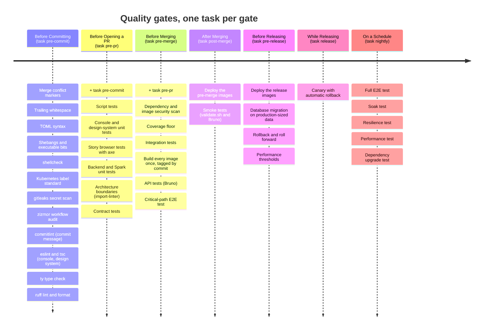

# Quality Gates: From Commit to Canary

A change to retail-lakehouse passes six quality gates on its way from a developer's laptop to production traffic, and a seventh gate runs every night alongside them. Each gate asks one question and runs only the checks that can answer it. **A gate costs more to run than the gate before it, so cheap checks fail fast and expensive ones run only on changes that already passed everything cheaper.**

The gates live in `tasks/checks.yml`, and the root `Taskfile.yml` exposes each one as `task <gate>`. **The Taskfile says *how* to test, and CI decides *when*.** A gate is a list of test tasks. Each test task, such as `task checks:unit-test`, also runs on its own.

## The Journey



Each column lists its checks in the order they run. `+ task pre-commit` and `+ task pre-pr` mark where a gate runs the whole gate before it, so a gate never repeats the work of the one before it in a different order.

On a Schedule sits at the end of the line but does not follow While Releasing. It runs against staging on a timer, apart from any single change.

## The Gates

Each gate answers its question in a specific environment. **The environment grows with the gate.** Pre-PR needs no running services. Pre-merge builds a short-lived platform for one merge candidate. Post-merge and later gates run on long-lived clusters with the same images that pre-merge built.

| Gate | Command | Question it answers | Where it runs |
|---|---|---|---|
| Pre-commit | `task pre-commit` | Is the code clean? | Laptop, on every `git commit` |
| Pre-PR | `task pre-pr` | Is my change logically correct? | Laptop or CI, no services |
| Pre-merge | `task pre-merge` | Will `main` still work after this merge? | Merge queue candidate on a short-lived platform |
| Post-merge | `task post-merge KUBE_CONTEXT=…` | Is `main` healthy once deployed to the shared environment? | Staging |
| Pre-release | `task pre-release KUBE_CONTEXT=…` | Can this exact build go to production? | Production-like cluster with production-scale data |
| Release | `task release` | Does the release hold under real traffic? | Production canary |
| Nightly | `task nightly KUBE_CONTEXT=…` | Are there problems that only show over time? | Staging, on a schedule |

### Run One Side

**A change to the console should not wait for the backend's 2,000 tests, and the reverse.** The three local gates, pre-commit, pre-PR and pre-merge, take a `scope` of `frontend`, `backend` or `all`, which is the default:

```bash
task pre-commit
task pre-pr scope=frontend
task pre-merge scope=backend
```

Each of these gates runs a shared part, then `<gate>-frontend`, `<gate>-backend` or both. The shared part holds the checks that belong to neither side, such as the secret scan, shellcheck and the script tests, and the checks that span both sides, such as `contract-test`, `api-test` and `e2e-critical-test`. It runs whatever the scope. A gate passes its `scope` to the gate it starts, so `task pre-merge scope=frontend` runs the frontend half of pre-PR and pre-commit as well. Each half also runs on its own, for example `task checks:pre-pr-backend`, and `task` rejects any other `scope` value before it runs anything.

Frontend means the console (`src/data-platform/frontend`) and the design system (`src/design-system`). Backend means every Python project, including the Spark runtime. Post-merge and the later gates test the whole deployed platform and take no `scope`.

### Pre-commit

**Pre-commit keeps style arguments, type errors and leaked secrets out of code review.** `.pre-commit-config.yaml` installs two Git hooks. The `pre-commit` hook runs every check below on the staged files, and each check's `Files` pattern decides whether it fires, so a commit that only touches the console never starts ruff. The `commit-msg` hook runs `commitlint` on the message, so it runs only on a real `git commit`, never from `task pre-commit`.

**Every hook carries an `alias` naming its group**, and `pre-commit run <group> --all-files` runs only that group. `task pre-commit` runs the `shared` group on every file, then `frontend`, `backend` or both, as its `scope` asks. A new hook needs an alias, or no gate runs it.

| Group | Hook | Source | What it checks | Files |
|---|---|---|---|---|
| shared | `identity` | `meta` | Prints the files each hook receives, for troubleshooting | All |
| shared | `check-hooks-apply` | `meta` | Every configured hook matches at least one file | `.pre-commit-config.yaml` |
| shared | `check-merge-conflict` | `pre-commit-hooks` | No leftover merge conflict markers | All |
| shared | `trailing-whitespace` | `pre-commit-hooks` | No trailing whitespace (fixes it) | Text |
| shared | `check-toml` | `pre-commit-hooks` | TOML files parse | `*.toml` |
| shared | `check-executables-have-shebangs` | `pre-commit-hooks` | Executable files start with a shebang | Executables |
| shared | `check-shell-scripts-are-executable` | local | Shell scripts have the executable bit | Shell |
| shared | `shellcheck` | local | Shell script static analysis | Shell |
| shared | `k8s-labels` | local | Manifests follow the Kubernetes label standard (`scripts/check_k8s_labels.py`) | `platform/` |
| shared | `commitlint` | local, `commit-msg` stage | Conventional commit message | Commit message |
| shared | `gitleaks` | `gitleaks` | No committed secrets | All |
| shared | `zizmor` | `zizmor-pre-commit` | GitHub Actions workflows are valid and safe | `.github/workflows/`, `.github/actions/` |
| frontend | `eslint-console` | local | Console lint | `src/data-platform/frontend/` |
| frontend | `tsc-console` | local | Console type check, which also covers its use of the design system | Console, design system, `package-lock.json` |
| frontend | `eslint-design-system` | local | Design-system lint | `src/design-system/` |
| frontend | `tsc-design-system` | local | Design-system type check | Design system, `package-lock.json` |
| backend | `ty` | local | Type check outside the backend project | Python |
| backend | `ty-backend` | local | Type check the backend project | `src/data-platform/backend/` |
| backend | `uv-export-backend` | local | `src/data-platform/backend/requirements.txt` matches `uv.lock` | `uv.lock`, backend `pyproject.toml` |
| backend | `ruff-check` | `ruff-pre-commit` | Python lint (fixes what it can) | Python |
| backend | `ruff-format` | `ruff-pre-commit` | Python formatting | Python |

The checks finish in seconds on staged files, so they run on every commit. `tsc` checks a whole project rather than the staged files, which makes the frontend hooks the slowest of the set, but a type error caught at commit time is still cheaper than one caught in review. `ruff` and `ty` check the scripts under `scripts/` as well, so they sit in the backend group with the rest of the Python tooling.

### Pre-PR

**Pre-PR proves the change is correct before anyone else spends time on it.** It first runs pre-commit on every file, then the script tests (`unit-test-scripts`). `pre-pr-frontend` runs the console and design-system unit suites in parallel (`unit-test-frontend`, `unit-test-design-system`), then `component-test`, which runs every design-system story in a browser with axe and its keyboard play function. `pre-pr-backend` runs the backend and Spark unit suites in parallel (`unit-test-backend`, `unit-test-spark`), then `arch-test`, which enforces the bounded-context boundaries with `lint-imports`. `contract-test` comes last for either side, because it checks the console's API types against the backend. Nothing here starts a container, so a red pre-PR always points at the code, never at the environment.

### Pre-merge

**Pre-merge tests the commit that will land on `main`, not the commit the author pushed.** A merge queue rebases each candidate on the latest `main` and runs the gate on the result. Two pull requests that pass separately can still break `main` together, and this gate catches that. It first runs all of pre-PR. `pre-merge-frontend` then scans, measures coverage of and builds the console (`security-test-frontend`, `coverage-test-frontend`, `build-test-frontend`), and `pre-merge-backend` does the same for the backend and Spark runtime, with `integration-test` before the build. `api-test` and `e2e-critical-test` exercise the whole platform, so they run last for either side.

Pre-merge also builds the deliverables. `build-test` builds `table-maintenance-backend`, `table-maintenance-spark` and the console once, tags them with the commit, and pushes them to the registry. **Every later gate deploys those same images and never rebuilds them**, so what passed pre-merge is exactly what reaches production. The API tests and the critical-path end-to-end test then run against a short-lived platform started from those images, which is torn down afterwards.

### Post-merge

**Post-merge catches what only a shared, long-lived environment exposes**: leftover state, real network policies, other teams' traffic. It deploys the pre-merge images to staging with `deployment-test`. Then `smoke-test` checks that the platform answers, using `task apps:validate` and a read-only Bruno collection sent through the gateway.

### Pre-release

**Pre-release checks the risks that only matter at production scale.** `migration-test` runs the database migrations against a production-sized copy of `table-maintenance-db`. `rollback-test` rolls back to the previous release and forward again. `performance-test` measures maintenance run duration, catalog API latency and console bundle size against thresholds.

### Release

**Release is a test, not a switch.** `canary-test` sends a small share of production traffic to the new version and compares its error rate and latency with the current version. If they get worse, it rolls back automatically.

### Nightly

**Nightly runs the tests too slow to run on every merge.** `e2e-full-test` runs `platform/25-lakehouse-control-plane/e2e.sh` end to end. `soak-test` keeps CDC and maintenance running for hours. `resilience-test` kills Kafka, RustFS, Polaris, Temporal or the backend database during a run. `dependency-test` tries the next `uv lock --upgrade` and `npm update`. A nightly failure does not block a merge. It opens work for the next day.

## What Runs Today

Most test tasks are planned but not built yet. **A planned task prints `TODO:// …` describing what it will do and exits 0**, so every gate already runs from start to finish, and building a task out never changes the gate's shape.

| Test task | Gate | Status |
|---|---|---|
| `pre-commit`, `pre-commit-frontend`, `pre-commit-backend` | Pre-commit | Runs |
| `unit-test-scripts`, `unit-test-frontend`, `unit-test-design-system`, `component-test` | Pre-PR | Runs |
| `unit-test-backend` | Pre-PR | Runs |
| `unit-test-spark` | Pre-PR | Planned |
| `arch-test` | Pre-PR | Runs |
| `contract-test` | Pre-PR | Planned |
| `security-test-*`, `coverage-test-*`, `integration-test` | Pre-merge | Planned |
| `build-test-frontend` | Pre-merge | Console build runs; image build planned |
| `build-test-backend` | Pre-merge | Planned |
| `api-test`, `e2e-critical-test` | Pre-merge | Planned |
| `deployment-test` | Post-merge, pre-release | Planned |
| `smoke-test` | Post-merge | `apps:validate` runs; Bruno planned |
| `migration-test`, `rollback-test`, `performance-test` | Pre-release | Planned |
| `canary-test` | Release | Planned |
| `e2e-full-test` | Nightly | Runs |
| `soak-test`, `resilience-test`, `dependency-test` | Nightly | Planned |

## References

- [Powertools for AWS Lambda (Python): contributing guide](https://github.com/aws-powertools/powertools-lambda-python/blob/develop/CONTRIBUTING.md), the "Code integration journey" timeline this page adapts
- [GitHub Docs: Managing a merge queue](https://docs.github.com/en/repositories/configuring-branches-and-merges-in-your-repository/configuring-pull-request-merges/managing-a-merge-queue)
- [Martin Fowler: The Practical Test Pyramid](https://martinfowler.com/articles/practical-test-pyramid.html)
- [Google SRE Workbook: Canarying Releases](https://sre.google/workbook/canarying-releases/)
- [Mermaid: Timeline diagrams](https://mermaid.js.org/syntax/timeline.html)
- [Task: Taskfile documentation](https://taskfile.dev/docs/guide)
